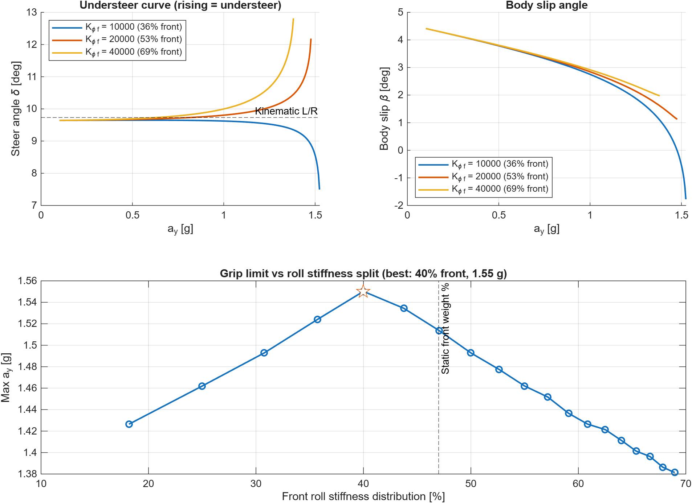
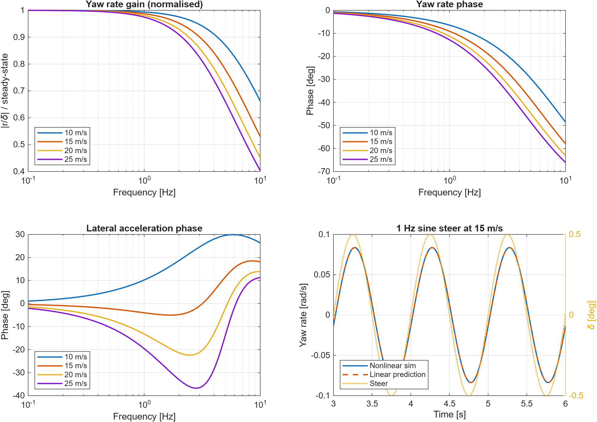

# Two-Track Vehicle Model (MATLAB)

A two-track (four-wheel) vehicle dynamics model of a Formula Student car, built from first principles in MATLAB, with no toolboxes or prebuilt vehicle blocks.

Built alongside my work in the Southampton Formula Student vehicle dynamics sub-team.

## Why two-track?
A bicycle model lumps each axle into one tyre, so it can't see lateral load transfer. Tyre grip is non-linear with vertical load, so the way load moves between the inside and outside wheels sets the car's balance. A two-track model captures this, which makes it possible to study setup levers like the roll stiffness distribution (anti-roll bars).

## Status
| Stage | Description | Status |
|---|---|---|
| 1 | Vehicle parameters (`params.m`) | Done |
| 2 | Quasi-static load transfer: longitudinal, lateral (geometric + elastic split), aero (`loadTransfer.m`) | Done |
| 3 | Tyre model: simplified Pacejka with load sensitivity (`tyreLateral.m`) | Done |
| 4 | 3-DOF equations of motion: vx, vy, yaw rate, integrated with `ode45` (`vehicleODE.m`) | Done |
| 5 | Steady-state cornering on the skidpad radius: understeer gradient, max lateral g, optimum roll stiffness split (`steadyState.m`) | Done |
| 6 | Transient: linearised yaw/lateral frequency response at several speeds, checked against a nonlinear sine steer (`linearise.m`) | Done |
| 7 | Validation against a bicycle model and team data | Planned |

## Findings by stage

All results use the placeholder parameters above, so the **trends and mechanisms** are the findings. The exact numbers will change once real car data goes in.

### Stage 2: Load transfer
- **Question:** How is load spread across the four tyres in braking, acceleration and cornering, and what does the roll stiffness split change?
- **What we did:** Calculated corner loads for four manoeuvres, then doubled the front roll stiffness.
- **Finding:** At 1.5 g cornering the inside front drops to about 230 N. Doubling the front roll stiffness moves more lateral load transfer onto the front axle and cuts that to about 87 N. Doubling it again lifts the wheel completely. **Roll stiffness distribution decides which axle takes the load transfer.**

### Stage 3: Tyre load sensitivity
- **Question:** Why does load transfer cost grip?
- **What we did:** Built a Pacejka tyre model where friction falls with load, then compared each axle's peak grip with and without lateral load transfer.
- **Finding:** Peak μ falls from about 1.8 at light load to about 1.3 at heavy load, so the outside tyre gains less grip than the inside tyre loses. Shifting roll stiffness forwards moves the grip loss forwards (front loss rises from 3.8 % to 12.4 %). **This is the mechanism by which anti-roll bars tune balance.**

### Stage 4: Equations of motion
- **Question:** Does the full 3-DOF model behave like a real car?
- **What we did:** Ran four checks (straight line, low-speed kinematic yaw rate, left/right symmetry, no wheel lift) and a 4° step steer at 15 m/s.
- **Finding:** All checks pass, and the low-speed yaw rate matches v·δ/L to within 0.1 %. The car settles in about 0.3 s at 1.01 g.
- **Problem found:** The first run showed wheel-lift warnings, although the final loads never fell below 385 N. The cause was numerical: an instant steer step combined with large solver steps made `ode45` try trial points that briefly predicted lift. **Fix:** a 0.1 s steer ramp (as in ISO 7401) and a 0.01 s maximum step.

### Stage 5: Steady-state cornering
- **Question:** What is the car's balance and grip limit on the skidpad, and what roll stiffness split maximises it?
- **What we did:** Swept speed on the 9.125 m skidpad radius, solving for steady-state equilibrium at each speed, for 19 different front/rear roll stiffness splits.
- **Finding:** Max lateral g peaks at **40 % front roll stiffness (1.55 g)**, compared with 1.48 g at the baseline 53 %. Below 40 % the rear saturates first (limit oversteer); above it the front does (limit understeer). The optimum is **not** the static front weight distribution (47 %), so the model was needed to find it.
- **Problem found:** With parallel steer, a stiffer front gave *more* oversteer in the linear range, the opposite of expectation. On a tight radius the outer front tyre runs a far larger slip angle than the inner one (1.7° vs 0.6°), so moving load onto it *increased* front grip. **Fix:** added geometric Ackermann as a parameter. With it, the understeer gradient rises with front roll stiffness as expected (0.020 → 0.116 deg/g).

### Stage 6: Transient response
- **Question:** How quickly and how stably does the car respond to steering, and how does that change with speed?
- **What we did:** Linearised the model about straight-line driving, computed the yaw-rate and lateral-acceleration frequency response at 10–25 m/s, and checked it against a nonlinear 1 Hz sine steer.
- **Finding:** The car is stable and slightly overdamped (ζ ≈ 1.02) at all speeds. Yaw-rate lag at 1 Hz doubles from 6.5° at 10 m/s to 12.8° at 25 m/s, so the car feels lazier at speed. At low speed lateral acceleration *leads* the steer, because the front tyres produce force before the car has rotated. The linear and nonlinear results agree to within 0.1 %.

### Next
- **Stage 7:** validate against a bicycle model, then against Southampton FS skidpad data.
- Replace the placeholder parameters with measured car data, and fit the tyre model to test data.
- Model improvements: combined slip, tyre relaxation length, roll dynamics.

## Usage
```matlab
test_loadTransfer   % sanity checks + corner loads for 4 manoeuvres
test_tyre           % tyre curves, load sensitivity, axle grip loss
test_vehicleODE     % straight-line, kinematic and symmetry checks + step steer
test_steadyState    % constant-radius sweep, understeer curves, roll-split optimum
test_frequencyResponse  % yaw-rate gain/phase vs frequency, linear vs nonlinear check
```

## Parameters and assumptions

> **All parameters are placeholder estimates for a typical Formula Student car. None are measured values from the Southampton car.** They are chosen to be physically plausible so the model's behaviour can be developed and checked, and will be replaced with team data as it becomes available. Every value lives in `params.m`.

### Vehicle parameters
| Parameter | Symbol | Value | Basis |
|---|---|---|---|
| Total mass (incl. driver) | m | 280 kg | Typical FS combustion car (~200 kg) + 80 kg driver |
| Wheelbase | L | 1.55 m | FS rules minimum is 1.525 m; most cars sit just above |
| Static front weight fraction | w_f | 0.47 | Slightly rear-biased, typical for a rear-engined RWD car |
| Front / rear track | t_f, t_r | 1.22 / 1.20 m | Typical FS values |
| CG height | h | 0.30 m | Typical FS car with driver |
| Yaw inertia | I_zz | 120 kg·m² | Estimate, roughly m·(L/2)² |
| Front / rear roll centre height | h_rcf, h_rcr | 0.03 / 0.05 m | Low roll centres, rear slightly higher (typical) |
| Front / rear roll stiffness | K_φf, K_φr | 20,000 / 18,000 Nm/rad | Estimate, gives a near-neutral balance |
| Ackermann fraction | — | 1.0 | 100% geometric Ackermann (0 = parallel steer) |

### Aero
| Parameter | Symbol | Value | Basis |
|---|---|---|---|
| Downforce coefficient × area | C_L·A | 3.0 m² | Typical FS car with full aero package |
| Drag coefficient × area | C_D·A | 1.2 m² | Typical FS car with full aero package |
| Front aero balance | — | 0.45 | Estimate |
| Air density | ρ | 1.225 kg/m³ | ISA sea level |

### Tyre (simplified Pacejka, lateral only)
| Parameter | Symbol | Value | Basis |
|---|---|---|---|
| Stiffness factor | B | 17 | Tuned so peak force occurs at ~7° slip |
| Shape factor | C | 1.4 | Typical lateral value |
| Curvature factor | E | 0 | Simplest form |
| Peak friction at nominal load | μ₀ | 1.6 | Typical FS racing slick |
| Nominal load | F_z0 | 700 N | Roughly static corner load |
| Load sensitivity | k_μ | −0.15 | μ falls 15% per 100% increase in load |

These tyre values are **not fitted to tyre test data**. Fitting to real data (e.g. the FSAE Tire Test Consortium) is a planned improvement.

### Modelling assumptions
- **Rigid body, 3 DOF** (v_x, v_y, yaw rate). No roll, pitch or heave dynamics; roll only enters through quasi-static load transfer.
- **Quasi-static load transfer** using a_y ≈ v_x·r (exact in steady state, approximate in transients).
- **Lateral tyre forces only**, with no combined slip: drive force does not reduce lateral grip.
- **Geometric Ackermann** set by a single fraction. No bump steer, roll steer or compliance steer.
- **No tyre relaxation length**: tyre forces respond instantly to slip angle.
- **Rear-wheel drive** with a simple proportional speed-hold controller.
- **Constant aero coefficients**, with no ride-height or yaw sensitivity.
- SI units throughout. Axes: x forward, y left, z up (ISO 8855).

## Example result
Skidpad at 1.5 g, 15 m/s. Doubling the front roll stiffness (20 → 40 kNm/rad) cuts the inside front load from about 230 N to about 87 N. That shifts lateral load transfer forwards and adds understeer.

## Tyre model and load sensitivity


Peak friction falls as vertical load rises, so lateral load transfer costs an axle grip: the outside tyre gains less than the inside tyre loses. Axle grip lost at a 1.5 g skidpad:

| Front roll stiffness [Nm/rad] | Front grip loss | Rear grip loss |
|---|---|---|
| 10,000 | 3.8 % | 11.6 % |
| 20,000 | 7.6 % | 6.9 % |
| 40,000 | 12.4 % | 3.5 % |

Shifting roll stiffness forwards moves the grip loss to the front axle, which means more understeer. This is the mechanism behind balance tuning with anti-roll bars.

## Step steer (stage 4)


4° of steer ramped in over 0.1 s at 15 m/s. The car settles within about 0.3 s at 1.01 g on a 22.6 m radius. The geometric radius at this steer angle is L/δ = 22.2 m, so the car turns slightly less than geometry predicts: mild understeer, consistent with the near-equal front and rear grip losses above.

Checks: a straight line stays straight; the low-speed yaw rate matches the kinematic value v·δ/L to within 0.1%; left and right turns are exact mirror images; no wheel lifts during the manoeuvre.

## Steady-state cornering (stage 5)


A constant-radius test in the style of ISO 4138, on the FS skidpad centreline radius (R = 9.125 m). At each speed, Newton-Raphson finds the steer angle and body slip that hold the car on the circle with zero lateral and yaw acceleration. Speed is raised until no equilibrium exists. That point is the grip limit.

| Front roll stiffness | Front share | Understeer gradient | Max a_y | Limiting axle |
|---|---|---|---|---|
| 10,000 Nm/rad | 36 % | 0.020 deg/g | 1.52 g | Rear |
| 20,000 Nm/rad | 53 % | 0.068 deg/g | 1.48 g | Front |
| 40,000 Nm/rad | 69 % | 0.116 deg/g | 1.38 g | Front |

**Key result:** with these placeholder parameters, the grip limit peaks at about **40 % front roll stiffness (1.55 g)**. Below that the rear saturates first (limit oversteer); above it the front does (limit understeer). The optimum is where both axles run out of grip together.

The understeer curve shows the same thing: at 36 % front the steer angle drops sharply near the limit (the rear lets go), while at 53 % and 69 % it climbs steeply (the front washes out).

**Ackermann matters on a tight radius.** With parallel steer, the outer front tyre runs a much larger slip angle than the inner one. Stiffening the front then moves load onto the tyre doing the most work, which reverses the expected trend in the linear range. Adding geometric Ackermann removes that artefact, so Ackermann is now a parameter.

## Transient response (stage 6)


The model is linearised about straight-line driving using numerical Jacobians of the full nonlinear model, giving a 2-state system (lateral velocity, yaw rate). From it come the frequency response of yaw rate and lateral acceleration to steer (base MATLAB only, no Control Toolbox) and the stability of the yaw mode.

| Speed | Eigenvalues [1/s] | Damping ζ | Yaw gain r/δ [1/s] | Kinematic v/L [1/s] | Yaw-rate lag at 1 Hz |
|---|---|---|---|---|---|
| 10 m/s | −39, −56 | 1.02 | 6.47 | 6.45 | 6.5° |
| 15 m/s | −28, −40 | 1.02 | 9.72 | 9.68 | 9.1° |
| 20 m/s | −22, −32 | 1.02 | 12.97 | 12.90 | 11.2° |
| 25 m/s | −19, −28 | 1.02 | 16.24 | 16.13 | 12.8° |

- **Stable and slightly overdamped** at every speed tested (both eigenvalues real and negative), so the car settles without yaw overshoot.
- **Response slows with speed**: the eigenvalues move towards zero and the phase lag at 1 Hz roughly doubles from 10 to 25 m/s. This is the usual behaviour of a road vehicle.
- **Near-neutral in a straight line**: the yaw gain sits within 1 % of the kinematic value. It is slightly above kinematic, meaning a very small amount of oversteer about the straight. That differs from the mild understeer seen on the skidpad, where load transfer and Ackermann come into play.
- **Linear vs nonlinear check:** a 0.5° sine steer at 1 Hz and 15 m/s in the full model gives a yaw gain of 9.59 1/s and a phase of −9.1°, matching the linear prediction to within 0.1 %.

**Caveat:** the tyres respond instantly (no relaxation length), so the phase lag here is a lower bound. Real tyres take about a tyre circumference to build up force, which adds lag at higher frequency.
