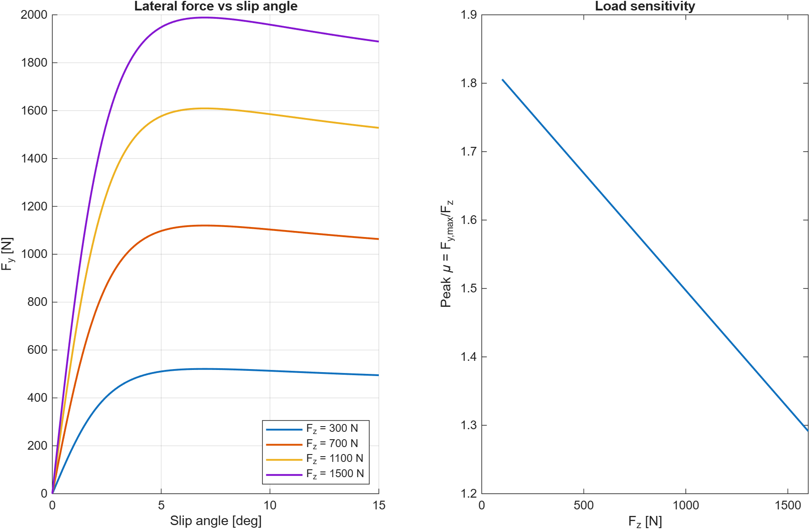
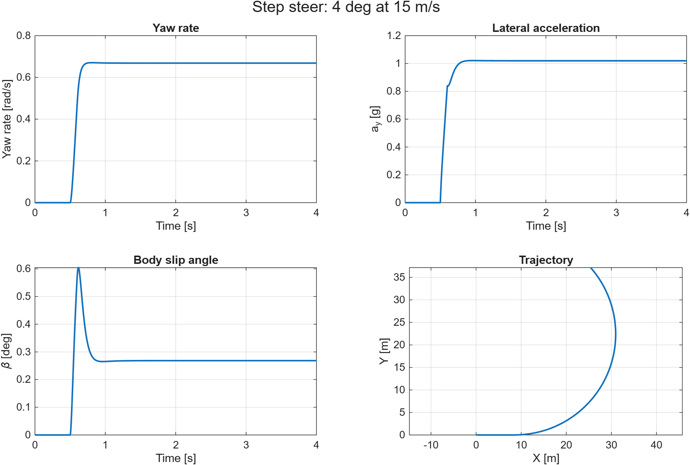

# Two-Track Vehicle Model (MATLAB)

A two-track (four-wheel) vehicle dynamics model of a Formula Student car, built from first principles in MATLAB, with no toolboxes or prebuilt vehicle blocks.

Built alongside my work in the Southampton Formula Student vehicle dynamics sub-team.

## Why two-track?
A bicycle model lumps each axle into one tyre, so it can't see lateral load transfer. Tyre grip is non-linear with vertical load, so the way load moves between the inside and outside wheels sets the car's balance. A two-track model captures this, which makes it possible to study setup levers like the roll stiffness distribution (anti-roll bars).

## Status
| Stage | Description | Status |
|---|---|---|
| 1 | Vehicle parameters (`params.m`) | Done |
| 2 | Quasi-static load transfer: longitudinal, lateral (geometric + elastic split), aero (`loadTransfer.m`) | Done |
| 3 | Tyre model: simplified Pacejka with load sensitivity (`tyreLateral.m`) | Done |
| 4 | 3-DOF equations of motion: vx, vy, yaw rate, integrated with `ode45` (`vehicleODE.m`) | Done |
| 5 | Steady-state cornering: understeer gradient, max lateral g | In progress |
| 6 | Transient: step steer and sine steer | Planned |
| 7 | Validation against a bicycle model and team data | Planned |

## Usage
```matlab
test_loadTransfer   % sanity checks + corner loads for 4 manoeuvres
test_tyre           % tyre curves, load sensitivity, axle grip loss
test_vehicleODE     % straight-line, kinematic and symmetry checks + step steer
```

## Parameters and assumptions

> **All parameters are placeholder estimates for a typical Formula Student car. None are measured values from the Southampton car.** They are chosen to be physically plausible so the model's behaviour can be developed and checked, and will be replaced with team data as it becomes available. Every value lives in `params.m`.

### Vehicle parameters
| Parameter | Symbol | Value | Basis |
|---|---|---|---|
| Total mass (incl. driver) | m | 280 kg | Typical FS combustion car (~200 kg) + 80 kg driver |
| Wheelbase | L | 1.55 m | FS rules minimum is 1.525 m; most cars sit just above |
| Static front weight fraction | w_f | 0.47 | Slightly rear-biased, typical for a rear-engined RWD car |
| Front / rear track | t_f, t_r | 1.22 / 1.20 m | Typical FS values |
| CG height | h | 0.30 m | Typical FS car with driver |
| Yaw inertia | I_zz | 120 kg·m² | Estimate, roughly m·(L/2)² |
| Front / rear roll centre height | h_rcf, h_rcr | 0.03 / 0.05 m | Low roll centres, rear slightly higher (typical) |
| Front / rear roll stiffness | K_φf, K_φr | 20,000 / 18,000 Nm/rad | Estimate, gives a near-neutral balance |

### Aero
| Parameter | Symbol | Value | Basis |
|---|---|---|---|
| Downforce coefficient × area | C_L·A | 3.0 m² | Typical FS car with full aero package |
| Drag coefficient × area | C_D·A | 1.2 m² | Typical FS car with full aero package |
| Front aero balance | — | 0.45 | Estimate |
| Air density | ρ | 1.225 kg/m³ | ISA sea level |

### Tyre (simplified Pacejka, lateral only)
| Parameter | Symbol | Value | Basis |
|---|---|---|---|
| Stiffness factor | B | 17 | Tuned so peak force occurs at ~7° slip |
| Shape factor | C | 1.4 | Typical lateral value |
| Curvature factor | E | 0 | Simplest form |
| Peak friction at nominal load | μ₀ | 1.6 | Typical FS racing slick |
| Nominal load | F_z0 | 700 N | Roughly static corner load |
| Load sensitivity | k_μ | −0.15 | μ falls 15% per 100% increase in load |

These tyre values are **not fitted to tyre test data**. Fitting to real data (e.g. the FSAE Tire Test Consortium) is a planned improvement.

### Modelling assumptions
- **Rigid body, 3 DOF** (v_x, v_y, yaw rate). No roll, pitch or heave dynamics; roll only enters through quasi-static load transfer.
- **Quasi-static load transfer** using a_y ≈ v_x·r (exact in steady state, approximate in transients).
- **Lateral tyre forces only**, with no combined slip: drive force does not reduce lateral grip.
- **No Ackermann**: both front wheels steer by the same angle.
- **No tyre relaxation length**: tyre forces respond instantly to slip angle.
- **Rear-wheel drive** with a simple proportional speed-hold controller.
- **Constant aero coefficients**, with no ride-height or yaw sensitivity.
- SI units throughout. Axes: x forward, y left, z up (ISO 8855).

## Example result
Skidpad at 1.5 g, 15 m/s. Doubling the front roll stiffness (20 → 40 kNm/rad) cuts the inside front load from about 230 N to about 87 N. That shifts lateral load transfer forwards and adds understeer.

## Tyre model and load sensitivity


Peak friction falls as vertical load rises, so lateral load transfer costs an axle grip: the outside tyre gains less than the inside tyre loses. Axle grip lost at a 1.5 g skidpad:

| Front roll stiffness [Nm/rad] | Front grip loss | Rear grip loss |
|---|---|---|
| 10,000 | 3.8 % | 11.6 % |
| 20,000 | 7.6 % | 6.9 % |
| 40,000 | 12.4 % | 3.5 % |

Shifting roll stiffness forwards moves the grip loss to the front axle, which means more understeer. This is the mechanism behind balance tuning with anti-roll bars.

## Step steer (stage 4)


4° of steer ramped in over 0.1 s at 15 m/s. The car settles within about 0.3 s at 1.02 g on a 22.4 m radius. The geometric radius at this steer angle is L/δ = 22.2 m, so the car turns slightly less than geometry predicts: mild understeer, consistent with the near-equal front and rear grip losses above.

Checks: a straight line stays straight; the low-speed yaw rate matches the kinematic value v·δ/L to within 0.1%; left and right turns are exact mirror images; no wheel lifts during the manoeuvre.
